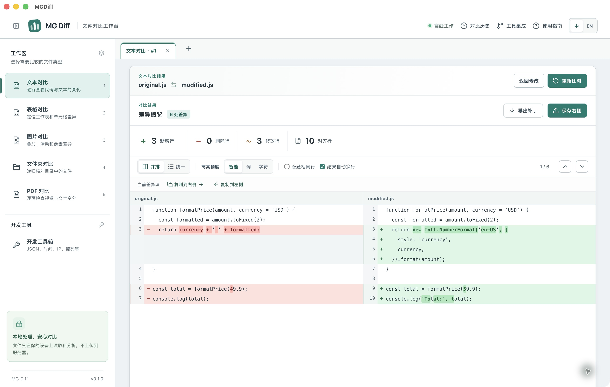
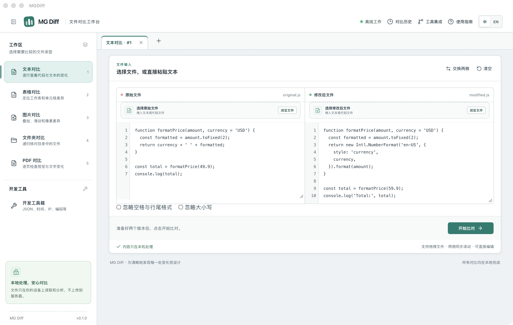

<p align="center">
  
</p>

<h1 align="center">MGDiff</h1>

<p align="center">Compare text, spreadsheets, images, folders, and PDFs clearly on your own computer.</p>

<p align="center">
  <a href="README.md">简体中文</a> ·
  <a href="https://github.com/workhold/mgdiff/releases">Download the latest release</a> ·
  <a href="docs/git-integration.en.md">Git integration guide</a>
</p>

MGDiff is a desktop file comparison tool built with Tauri 2, React, and TypeScript. Files are read, parsed, and compared locally; they are not uploaded to a server. The interface supports Simplified Chinese and English. It follows your system language on first launch, and you can switch languages from the top right at any time.

## Screenshots

This is a real comparison of the sample code included in the app. You can inspect changes side by side and jump between differences.



<details>
<summary>Show the input screen</summary>



</details>

## Download and install

Open [GitHub Releases](https://github.com/workhold/mgdiff/releases), select the latest version, and download the installer for your device:

| Platform | Installer |
| --- | --- |
| macOS on Apple Silicon (M series) | `.dmg` |
| macOS on Intel | `.dmg` |
| Windows | `.exe` installer |

On macOS, open the DMG and drag MGDiff to Applications. On Windows, run the installer. The current release packages are not Apple notarized or signed with a Windows code signing certificate, so your system may show a security prompt. Verify that the file came from this repository's Releases page before using the system's Open or Run anyway option.

## Quick start

1. Select Text, Spreadsheet, Image, Folder, or PDF comparison in the sidebar.
2. Choose the old and new versions. For text, you can also paste or edit content directly.
3. Click **Start comparing**. Inspect, filter, navigate, or export changes on the results screen.

The initial text workspace already contains sample code. Click **Start comparing** immediately to see the result shown above. The top bar provides local comparison history, Git tool integration, and help. Press `⌘ / Ctrl + 1–5` to switch between the five comparison modes.

## Features

| Mode | Input | Main capabilities |
| --- | --- | --- |
| Text and code | UTF-8 text and common code files | Split/unified diff, word or character highlighting, options to ignore whitespace/case/line ending format, difference navigation, two-way merging, patch export, and saving |
| Spreadsheets | `.csv`, `.tsv`, `.xlsx` | Match worksheets by name, align by first-column key or row number, find row, cell value, and formula changes, filter and export reports |
| Images | Decodable formats such as PNG, JPG, WebP, and GIF | Side by side, opacity overlay, slider, heatmap, pixel subtraction, and blink views; adjustable tolerance and difference PNG export |
| Folders | Local directories | Recursive scan with SHA-256 content comparison, searchable/filterable tree, and drill-down into text files |
| PDFs | `.pdf` | Page-by-page visual pixel comparison, highlighted difference regions, and extracted text differences |

### Developer toolbox

Twelve offline tools are included: JSON validation/formatting/minification, Unix timestamps, date arithmetic, base 2–36 conversion, IPv4/IPv6 and CIDR analysis, Base64, URL encoding/decoding, HTML entities, SHA-256/384/512, UUID v4, JWT decoding, and regex testing. Search the tools and copy results with one click. JWTs are decoded without signature verification. Regex tests run in a separate Worker and stop after one second.

### Comparison history

After each comparison, MGDiff stores the type, file names, time, and a difference summary locally. Open **History** in the top bar to search, filter, delete, or reopen records that include an input snapshot. History prefers IndexedDB and observes these snapshot limits:

- Text: both sides combined must be no more than 2 MiB.
- Spreadsheets, images, and PDFs: no more than 16 MiB per file and 24 MiB combined.
- Folders retain a summary only; you must select the directories again to reopen them.

A record may retain only its summary when a limit is exceeded or local storage is unavailable. History does not preserve result view settings. Git three-way merges are not added to comparison history.

## Command line and Git

The desktop executable accepts:

```text
mgdiff --diff <left> <right>
mgdiff --merge <base> <local> <remote> <merged>
```

`--diff` accepts two files or two directories and opens the matching comparison mode. `--merge` provides a three-way merge for UTF-8 text and writes to the specified `merged` file only after you click **Complete merge and write back**. A successful save followed by a normal exit returns status 0; cancellation or closing returns 1.

Installing MGDiff does not add `mgdiff` to `PATH`. Open **Integrations** in the top bar to see the actual executable path and copy the generated Git configuration commands. See the [Git integration guide](docs/git-integration.en.md) for complete `git difftool` / `git mergetool` setup and directory mode instructions.

## Run from source

Install [Node.js 22](https://nodejs.org/) and the [Tauri 2 prerequisites](https://v2.tauri.app/start/prerequisites/) for your platform, including Rust. Then run:

```sh
git clone https://github.com/workhold/mgdiff.git
cd mgdiff
npm ci
npm run tauri dev
```

For browser-only frontend development, run `npm run dev` and open `http://127.0.0.1:1421/`. Use `npm run tauri build` for a production desktop build or `npm run build` for the frontend only.

## Releases

Maintainers update `package.json`, `src-tauri/tauri.conf.json`, and `src-tauri/Cargo.toml` to the same version, then push the matching `vX.Y.Z` tag. GitHub Actions builds installers for Apple Silicon Macs, Intel Macs, and Windows and attaches them to one [GitHub Release](https://github.com/workhold/mgdiff/releases) after every build succeeds.

## Scope and limitations

- `.xlsx` comparison checks cell values and formulas, but not styling, comments, or macros.
- PDF text extraction does not include OCR. Visual comparison renders each page with its longest side at 1600 pixels; missing fonts or rendering differences can affect pixel results.
- Animated images use the currently decoded frame. The folder tree shows directories containing files and does not list empty subdirectories on their own.
- JSON formatting parses and regenerates the document. Duplicate keys and numbers outside the safe integer range may change.

## Contributing

Bug reports and suggestions are welcome in [Issues](https://github.com/workhold/mgdiff/issues), and Pull Requests are welcome. Run `npm run build` before submitting code. Also verify desktop-related changes with `npm run tauri dev`.

## License

[MIT License](LICENSE).
