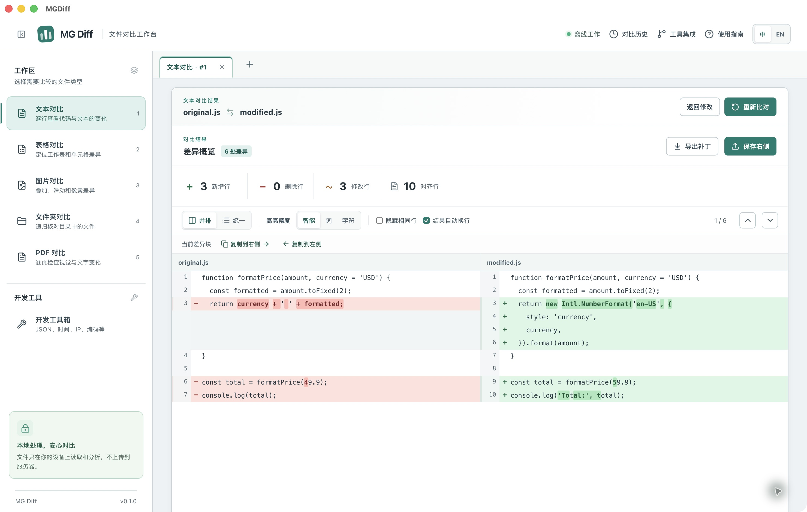
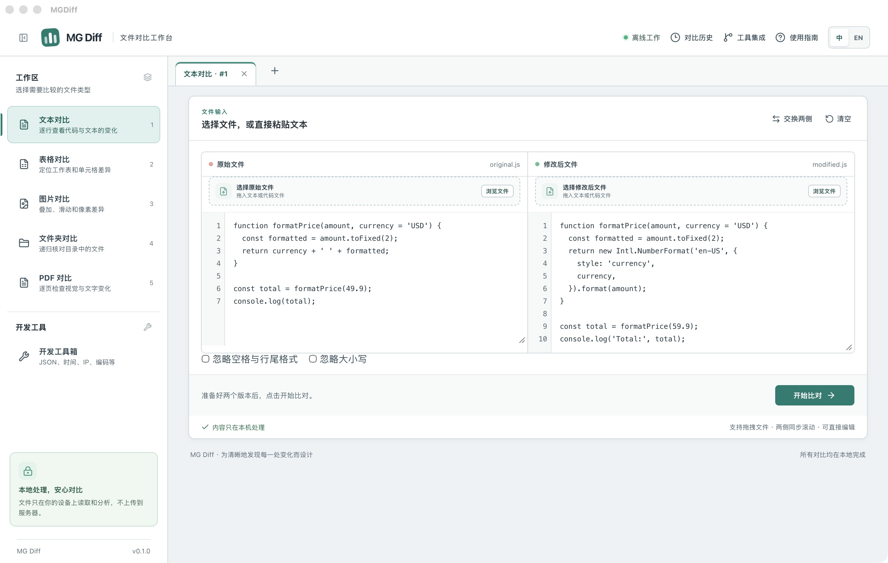

<p align="center">
  
</p>

<h1 align="center">MGDiff</h1>

<p align="center">在本机清晰地比较文本、表格、图片、文件夹和 PDF。</p>

<p align="center">
  <a href="README.en.md">English</a> ·
  <a href="https://github.com/workhold/mgdiff/releases">下载最新版本</a> ·
  <a href="docs/git-integration.md">Git 集成指南</a>
</p>

MGDiff 是基于 Tauri 2、React 和 TypeScript 的桌面文件对比工具。文件读取、解析和比较都在本机完成，不会上传到服务器。界面支持简体中文和英文，首次启动跟随系统语言，也可以随时在右上角切换。

## 界面预览

下图是应用内置示例实际运行后的文本对比结果，可并排查看修改并在差异之间跳转。



<details>
<summary>查看输入界面</summary>



</details>

## 下载安装

从 [GitHub Releases](https://github.com/workhold/mgdiff/releases) 选择最新版本，下载与你的设备对应的安装包：

| 平台 | 安装包 |
| --- | --- |
| macOS Apple Silicon（M 系列） | `.dmg` |
| macOS Intel | `.dmg` |
| Windows | `.exe` 安装程序 |

打开 macOS 的 DMG 并将 MGDiff 拖入“应用程序”；在 Windows 上运行安装程序。发布包目前没有 Apple 公证或 Windows 证书签名，系统可能显示安全提示。请先确认文件来自本仓库的 Releases 页面，再按系统提供的“打开”或“仍要运行”等选项继续。

## 快速上手

1. 在左侧选择文本、表格、图片、文件夹或 PDF 对比。
2. 选择左右两个版本；文本也可以直接粘贴或编辑。
3. 点击“开始比对”，在结果页查看差异、筛选、跳转或导出。

初次打开的文本工作区已填入示例代码，直接点击“开始比对”即可体验上方截图中的结果。顶部可打开本机对比历史、Git 工具集成和使用指南；`⌘ / Ctrl + 1–5` 可快速切换五种对比类型。

## 功能

| 类型 | 输入 | 主要能力 |
| --- | --- | --- |
| 文本与代码 | UTF-8 文本及常见代码文件 | 并排/统一差异、行内词或字符高亮、忽略空格/大小写/行尾格式、差异导航、双向合并、导出补丁及保存结果 |
| 表格 | `.csv`、`.tsv`、`.xlsx` | 按工作表名称匹配，按首列键或行号对齐，检查行、单元格值和公式变化，筛选并导出报告 |
| 图片 | PNG、JPG、WebP、GIF 等可解码图片 | 并排、透明叠加、滑块、热图、像素相减与闪烁视图，可调容差并导出差异 PNG |
| 文件夹 | 本机目录 | 递归扫描，按 SHA-256 对比文件内容，搜索/筛选目录树并下钻文本文件 |
| PDF | `.pdf` | 逐页比较视觉像素，定位差异区域，同时提取并比较文字 |

### 开发工具箱

内置 12 个离线工具：JSON 校验/格式化/压缩、Unix 时间戳、日期计算、2–36 进制转换、IPv4/IPv6 与 CIDR 分析、Base64、URL 编解码、HTML 实体、SHA-256/384/512、UUID v4、JWT 解码查看及正则测试。工具可搜索，结果可复制。JWT 只解码，不验证签名；正则测试在独立 Worker 中运行，超过 1 秒会停止。

### 对比历史

完成对比后，应用在本机记录类型、文件名、时间和差异摘要。可从顶部“对比历史”搜索、筛选、删除或重开有输入快照的记录。历史优先存入 IndexedDB，并受以下快照上限约束：

- 文本：两侧原文合计不超过 2 MiB。
- 表格、图片、PDF：单个文件不超过 16 MiB，两个文件合计不超过 24 MiB。
- 文件夹只保存差异摘要，重开时需要重新选择目录。

超过上限或本机存储空间不足时，记录可能只有摘要。历史不保存结果页的视图设置；Git 三方合并不会写入对比历史。

## 命令行与 Git

桌面版可执行文件支持：

```text
mgdiff --diff <left> <right>
mgdiff --merge <base> <local> <remote> <merged>
```

`--diff` 接收两个文件或两个目录并自动打开相应的对比模式。`--merge` 用于 UTF-8 文本三方合并；只有点击“完成合并并写回”才会写入指定的 `merged` 文件。成功保存并正常退出时返回 0，取消或关闭时返回 1。

安装应用不会自动把 `mgdiff` 加入 `PATH`。在应用顶部“工具集成”可查看实际可执行文件路径，并复制生成的 Git 配置命令。完整的 `git difftool` / `git mergetool` 设置与目录模式用法见 [Git 集成指南](docs/git-integration.md)。

## 从源码运行

先安装 [Node.js 22](https://nodejs.org/) 和对应平台的 [Tauri 2 前置依赖](https://v2.tauri.app/start/prerequisites/)（包括 Rust），然后执行：

```sh
git clone https://github.com/workhold/mgdiff.git
cd mgdiff
npm ci
npm run tauri dev
```

仅调试前端可运行 `npm run dev`，浏览器地址是 `http://127.0.0.1:1421/`。生产构建运行 `npm run tauri build`；仅构建前端运行 `npm run build`。

## 发布版本

维护者先将 `package.json`、`src-tauri/tauri.conf.json` 和 `src-tauri/Cargo.toml` 的版本号更新为同一版本，再推送对应的 `vX.Y.Z` 标签。GitHub Actions 会为 Apple Silicon、Intel Mac 和 Windows 构建安装包，并在全部构建成功后将它们附加到同一个 [GitHub Release](https://github.com/workhold/mgdiff/releases)。

## 范围与限制

- `.xlsx` 对比单元格值与公式，不比较样式、批注和宏。
- PDF 文字提取不包含 OCR；视觉比较将页面最长边渲染到 1600 像素，字体或渲染环境变化可能影响结果。
- 动图按当前解码帧处理；文件夹树只显示含文件的目录，不单独列出空的子目录。
- JSON 重排会经过标准解析，重复键及超出安全整数范围的数值可能变化。

## 参与贡献

欢迎通过 [Issues](https://github.com/workhold/mgdiff/issues) 报告问题或提出建议，也欢迎提交 Pull Request。提交代码前请运行 `npm run build`；涉及桌面能力的改动也请用 `npm run tauri dev` 验证。

## 许可证

[MIT License](LICENSE)。
